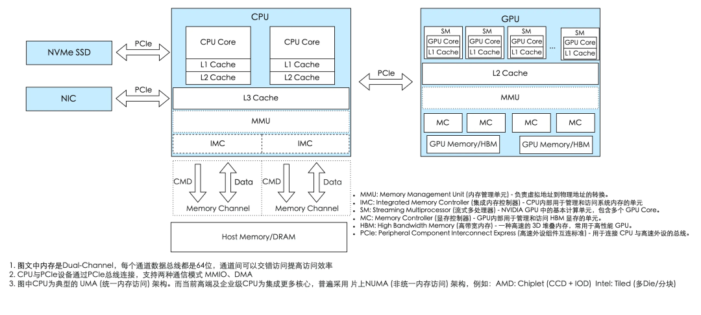

# CUDA 编程快速入门 - GPU 是如何工作的

## GPU vs CPU
首先需要知道，发明一样东西一定是为了解决现状的某种痛点

打个比方。假设你开了一家餐厅，现在有两种生意：

- **第一种**：来了一位极其挑剔的美食评论家，他点的菜工序复杂、步骤环环相扣——先腌制、再煎、中途要尝味道决定下一步怎么做。这活儿必须交给**一位经验极其丰富的大厨**，他脑子快、能随机应变、能处理各种突发状况。
- **第二种**：学校食堂要你一次性做一万份一模一样的蛋炒饭。工序简单到不能再简单：打蛋、下饭、翻炒、装盘。这时候你最需要的，**不是一个顶级大厨，而是一千个手脚麻利的普通厨师同时开炒**。

CPU 就是那个顶级大厨，GPU 就是那一千个普通厨师。

但 GPU 也不是万能的，具体使用 CPU 还是 GPU，取决于任务的性质。

GPU 的能力有个大前提：**任务必须能拆成大量互不依赖、可以同时跑的小块。** 学术上这叫 **数据并行（Data Parallelism）**，典型特征是"同一套运算，作用在一大堆不同的数据上"——也就是 **SIMT（Single Instruction, Multiple Threads，单指令多线程）**。

举几个"天生适合 GPU"的例子：

- **图形渲染**（GPU 的老本行）：屏幕上几百万个像素，每个像素的颜色都要算，而且彼此独立。这正是 GPU 名字的由来——Graphics Processing Unit，图形处理器。
- **矩阵乘法**：结果矩阵里每一个元素都是一次独立的"行乘列求和"。深度学习里铺天盖地的就是矩阵乘法，这也是 GPU 成为 AI 核心算力的根本原因。
- **向量 / 张量运算**：逐元素加减乘除、归一化、激活函数……成千上万个元素各算各的。

## CPU/GPU 异构计算架构

**GPU 不能独立工作，它只是 CPU 的"协处理器"（co-processor）。** 现代计算平台是一种 **异构架构（Heterogeneous Architecture）**——CPU 和 GPU 各司其职、配合完成任务。

CPU 是整个系统的核心，是总指挥，GPU 的任务指令是由 CPU 分配的。

CPU 通过 PCIe 总线给 GPU 发送指令和数据交互。而 PCIe 支持 DMA 和 MMIO 两种通讯模式：

- **MMIO（内存映射 I/O）** 由 CPU 直接控制数据读写，操作系统会把设备地址映射到 CPU 的虚拟空间中，适合小数据量的指令交互。
- **DMA（直接内存访问）** 则允许设备绕过 CPU 直接访问系统内存，专为大数据块的高效传输设计。

CPU 通过 IMC 和 Memory Channel 访问内存，为了提升数据传输带宽，高端 CPU 通常会支持多内存通道，即多 IMC 和 Memory Channel 的组合，以满足日益增长的数据处理需求。

## 一个简单的例子：数组加法

实现两个长度为 2³⁰ (约10亿) 的浮点数数组的相加。其中，一个数组 (x) 的所有元素初始化为 1.0，另一个数组 (y) 的所有元素初始化为 2.0，我们计算 y[i] = x[i] + y[i]。

### CPU 实现
~~~cpp
#include <iostream>
#include <math.h>
#include <chrono>

void add(float *x, float *y, int n) {
    for (int i = 0; i < n; i++)
        y[i] = x[i] + y[i];
}

int main() {
    int N = 1 << 30;

    float *x = new float[N];
    float *y = new float[N];
    
    for (int i = 0; i < N; i++) {
        x[i] = 1.0f;
        y[i] = 2.0f;
    }

    auto start = std::chrono::high_resolution_clock::now();

    add(N, x, y);

    auto stop = std::chrono::high_resolution_clock::now();
    uto duration = std::chrono::duration_cast<std::chrono::milliseconds>(stop - start);

    std::cout << "CPU 'add' function execution time: " << duration.count() << " ms" << std::endl;

    delete[] x;
    delete[] y;
    return 0;
}
~~~

**性能表现**：

~~~shell
g++ add.cpp -o add
time ./add

CPU 'add' function execution time: 3740 ms

real	0m21.418s
user	0m15.798s
sys	0m4.400s
~~~

* **计算耗时** : 核心的add函数耗时 3740毫秒。

* **总耗时** : 整个程序从启动到结束（real time）耗时 21.4秒。这额外的时间主要消耗在分配8GB内存（new float[N]）以及初始化数组上。

### GPU 实现

~~~cpp
#include <iostream>
#include <math.h>

#define CUDA_CHECK(call) \
do { \
    cudaError_t err = call; \
    if (err != cudaSuccess) { \
        fprintf(stderr, "CUDA Error in %s at line %d: %s\n", __FILE__, __LINE__, cudaGetErrorString(err)); \
        exit(EXIT_FAILURE); \
    } \
} while (0)

__global__ void add(float *x, float *y, int n) {
    int index = threadIdx.x + blockIdx.x * blockDim.x;
    if (index < n)
        y[index] = x[index] + y[index];
}

int main() {
    int N = 1 << 30;
    size_t bytes = N * sizeof(float);

    float *hx = new float[N];
    float *hy = new float[N];

    float *dx, *dy;
    CUDA_CHECK(cudaMalloc(&dx, bytes));
    CUDA_CHECK(cudaMalloc(&dy, bytes));

    for (int i = 0; i < N; i++) {
        hx[i] = 1.0f;
        hy[i] = 2.0f;
    }

    CUDA_CHECK(cudaMemcpy(dx, hx, bytes, cudaMemcpyHostToDevice));
    CUDA_CHECK(cudaMemcpy(dy, hy, bytes, cudaMemcpyHostToDevice));

    cudaEvent_t start, stop;
    CUDA_CHECK(cudaEventCreate(&start));
    CUDA_CHECK(cudaEventCreate(&stop));
    CUDA_CHECK(cudaEventRecord(start));

    int blockSize = 256;
    int gridSize = (N + blockSize - 1) / blockSize;
    add<<<gridSize, blockSize>>>(dx, dy, N);

    CUDA_CHECK(cudaEventRecord(stop));
    CUDA_CHECK(cudaEventSynchronize(stop));

    float elapsedTime;
    CUDA_CHECK(cudaEventElapsedTime(&elapsedTime, start, stop));
    printf("GPU 'add' function execution time: %.3f ms\n", elapsedTime);

    CUDA_CHECK(cudaMemcpy(hy, dy, bytes, cudaMemcpyDeviceToHost));
    CUDA_CHECK(cudaFree(dx));
    CUDA_CHECK(cudaFree(dy));
    CUDA_CHECK(cudaEventDestroy(start));
    CUDA_CHECK(cudaEventDestroy(stop));

    delete[] hx;
    delete[] hy;
    return 0;
}
~~~

**性能表现**：
~~~
nvcc  add.cu -o add_cu -gencode arch=compute_75,code=sm_75
time ./add_cu

GPU Kernel 'add' execution time: 48.6738 ms

real	0m19.413s
user	0m15.308s
sys	0m4.014s
~~~

* **计算耗时** : 核心的add函数耗时 48.6738毫秒。
* **总耗时** : 整个程序从启动到结束（real time）耗时 19.4秒。

单看核心计算任务，GPU (48.7ms) 的速度是CPU (3740ms) 的 约75倍。这完美体现了GPU在处理数据并行任务时的绝对优势。CPU需要串行执行10亿次加法(此处只考虑单核场景)，而GPU则将任务分配给成千上万个线程同时处理。

但是虽然GPU计算本身极快，但程序的总耗时 (19.4s) 却和CPU版本 (21.4s) 相差无几。这是为什么呢？主要是CPU和GPU通讯的开销。这里下一篇文章会详细介绍。

## Fat Binary

`nvcc add.cu -o add_cu -gencode arch=compute_75,code=sm_75` 上面的例子中，我们看到这个编译指令。add.cu 被编译为二进制文件 add_cu。它具体是怎么做的呢？

1、主机代码编译：将 C/C++ 代码（CPU 上执行的代码）交由主机的编译器（gcc、msvc 等）编译成 CPU 目标代码

2、设备代码编译：将 `__global__` 函数定义的 GPU 代码编译成两种格式：
* SASS（Streaming Assembler）：这是 GPU 架构的原生机器码。如为NVIDIA T4 GPU (Turing 架构 代号 sm_75 ) 编译的SASS，只能在该架构上最高效地运行。NVCC可以为多种指定的架构预编译多份SASS代码。
* PTX（Portable Threaded Execution）：这是 GPU 架构的中间代码。arch=compute_75 指示 PTX 可以在任何不低于 Turing 架构的 NVIDIA GPU 上通过 JIT 运行，但它运行效率不如 SASS 高。

这两种设备代码连同主机代码一起，被打包进一个可执行文件中，形成所谓的胖二进制 (Fat Binary)。它“胖”在包含了一份主机代码和多份针对不同GPU架构的设备代码。

