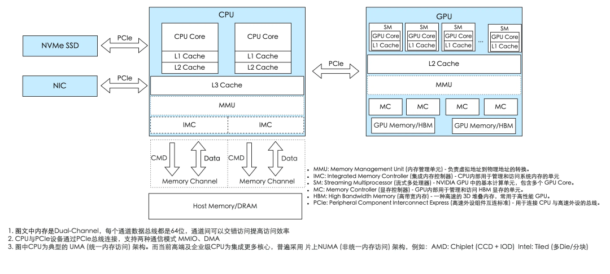
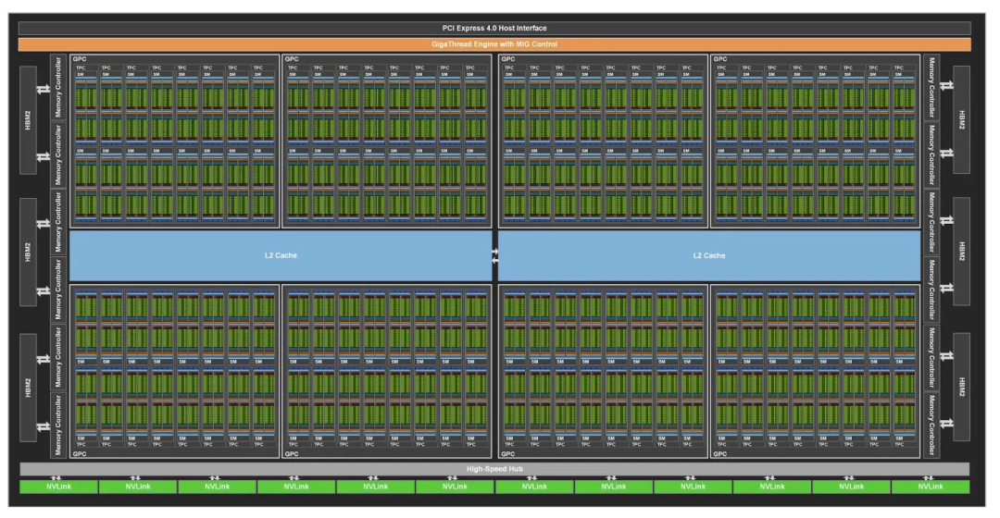
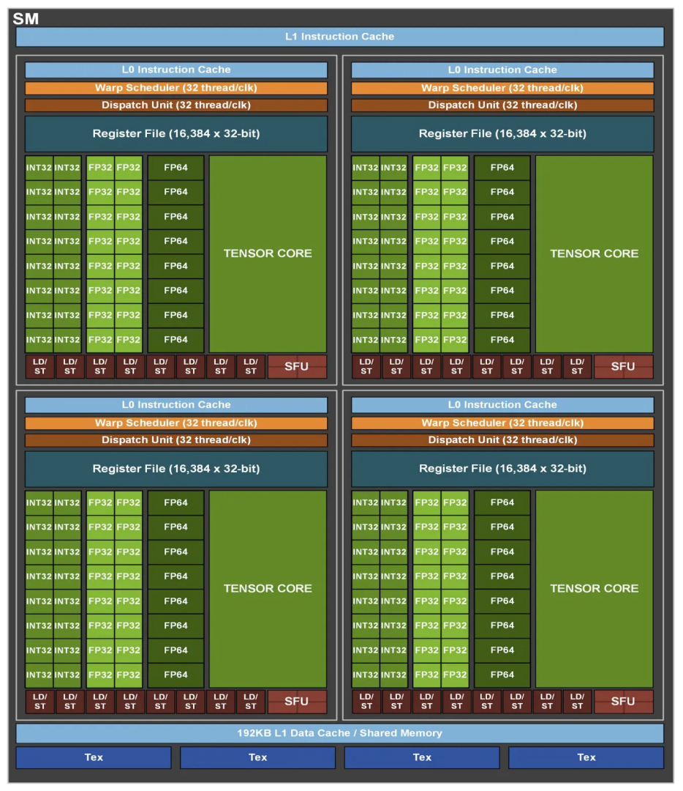
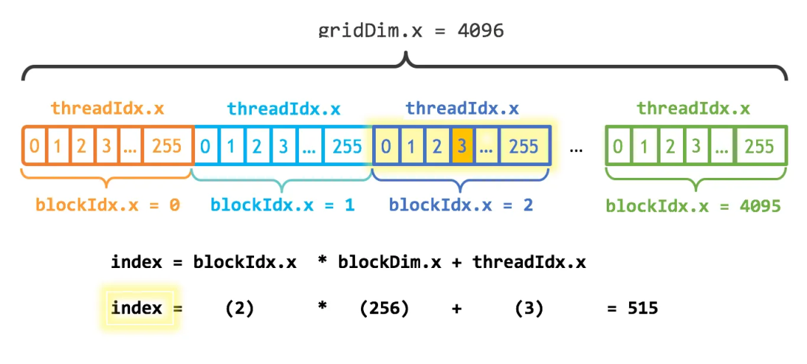
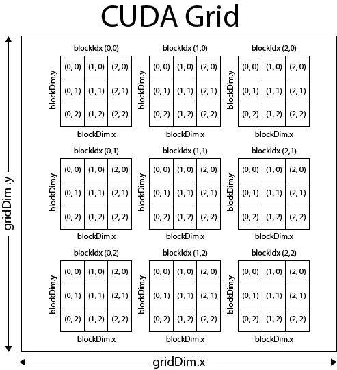
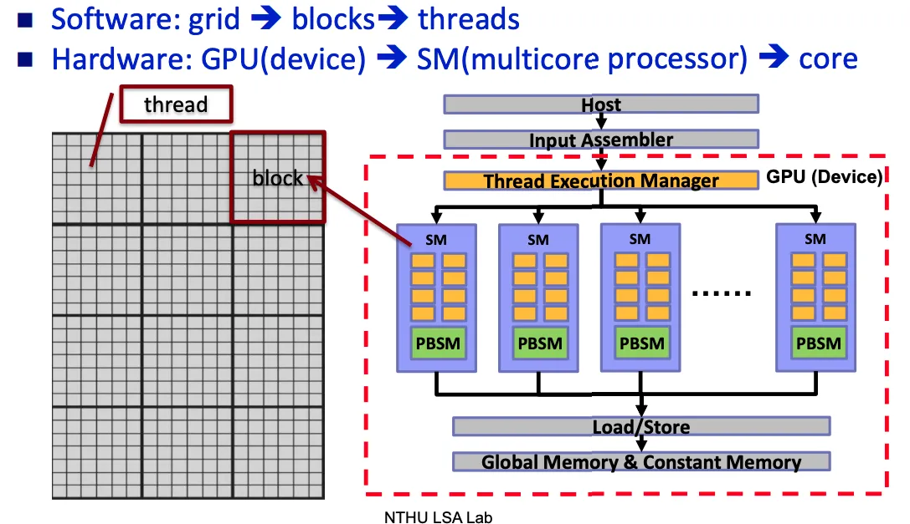

# CUDA 编程快速入门 - GPU 是如何工作的

## GPU vs CPU
首先需要知道，发明一样东西一定是为了解决现状的某种痛点

打个比方。假设你开了一家餐厅，现在有两种生意：

- **第一种**：来了一位极其挑剔的美食评论家，他点的菜工序复杂、步骤环环相扣——先腌制、再煎、中途要尝味道决定下一步怎么做。这活儿必须交给**一位经验极其丰富的大厨**，他脑子快、能随机应变、能处理各种突发状况。
- **第二种**：学校食堂要你一次性做一万份一模一样的蛋炒饭。工序简单到不能再简单：打蛋、下饭、翻炒、装盘。这时候你最需要的，**不是一个顶级大厨，而是一千个手脚麻利的普通厨师同时开炒**。

CPU 就是那个顶级大厨，GPU 就是那一千个普通厨师。

但 GPU 也不是万能的，具体使用 CPU 还是 GPU，取决于任务的性质。

GPU 的能力有个大前提：**任务必须能拆成大量互不依赖、可以同时跑的小块。** 学术上这叫 **数据并行（Data Parallelism）**，典型特征是"同一套运算，作用在一大堆不同的数据上"——也就是 **SIMT（Single Instruction, Multiple Threads，单指令多线程）**。

举几个"天生适合 GPU"的例子：

- **图形渲染**（GPU 的老本行）：屏幕上几百万个像素，每个像素的颜色都要算，而且彼此独立。这正是 GPU 名字的由来——Graphics Processing Unit，图形处理器。
- **矩阵乘法**：结果矩阵里每一个元素都是一次独立的"行乘列求和"。深度学习里铺天盖地的就是矩阵乘法，这也是 GPU 成为 AI 核心算力的根本原因。
- **向量 / 张量运算**：逐元素加减乘除、归一化、激活函数……成千上万个元素各算各的。

## CPU/GPU 异构计算架构

**GPU 不能独立工作，它只是 CPU 的"协处理器"（co-processor）。** 现代计算平台是一种 **异构架构（Heterogeneous Architecture）**——CPU 和 GPU 各司其职、配合完成任务。

CPU 是整个系统的核心，是总指挥，GPU 的任务指令是由 CPU 分配的。

CPU 通过 PCIe 总线给 GPU 发送指令和数据交互。而 PCIe 支持 DMA 和 MMIO 两种通讯模式：

- **MMIO（内存映射 I/O）** 由 CPU 直接控制数据读写，操作系统会把设备地址映射到 CPU 的虚拟空间中，适合小数据量的指令交互。
- **DMA（直接内存访问）** 则允许设备绕过 CPU 直接访问系统内存，专为大数据块的高效传输设计。

CPU 通过 IMC 和 Memory Channel 访问内存，为了提升数据传输带宽，高端 CPU 通常会支持多内存通道，即多 IMC 和 Memory Channel 的组合，以满足日益增长的数据处理需求。




## 一个简单的例子：数组加法

实现两个长度为 2³⁰ (约10亿) 的浮点数数组的相加。其中，一个数组 (x) 的所有元素初始化为 1.0，另一个数组 (y) 的所有元素初始化为 2.0，我们计算 y[i] = x[i] + y[i]。

### CPU 实现
~~~cpp
#include <iostream>
#include <math.h>
#include <chrono>

void add(float *x, float *y, int n) {
    for (int i = 0; i < n; i++)
        y[i] = x[i] + y[i];
}

int main() {
    int N = 1 << 30;

    float *x = new float[N];
    float *y = new float[N];
    
    for (int i = 0; i < N; i++) {
        x[i] = 1.0f;
        y[i] = 2.0f;
    }

    auto start = std::chrono::high_resolution_clock::now();

    add(N, x, y);

    auto stop = std::chrono::high_resolution_clock::now();
    uto duration = std::chrono::duration_cast<std::chrono::milliseconds>(stop - start);

    std::cout << "CPU 'add' function execution time: " << duration.count() << " ms" << std::endl;

    delete[] x;
    delete[] y;
    return 0;
}
~~~

**性能表现**：

~~~shell
g++ add.cpp -o add
time ./add

CPU 'add' function execution time: 3740 ms

real	0m21.418s
user	0m15.798s
sys	0m4.400s
~~~

* **计算耗时** : 核心的add函数耗时 3740毫秒。

* **总耗时** : 整个程序从启动到结束（real time）耗时 21.4秒。这额外的时间主要消耗在分配8GB内存（new float[N]）以及初始化数组上。

### GPU 实现

~~~cpp
#include <iostream>
#include <math.h>

#define CUDA_CHECK(call) \
do { \
    cudaError_t err = call; \
    if (err != cudaSuccess) { \
        fprintf(stderr, "CUDA Error in %s at line %d: %s\n", __FILE__, __LINE__, cudaGetErrorString(err)); \
        exit(EXIT_FAILURE); \
    } \
} while (0)

__global__ void add(float *x, float *y, int n) {
    int index = threadIdx.x + blockIdx.x * blockDim.x;
    if (index < n)
        y[index] = x[index] + y[index];
}

int main() {
    int N = 1 << 30;
    size_t bytes = N * sizeof(float);

    float *hx = new float[N];
    float *hy = new float[N];

    float *dx, *dy;
    CUDA_CHECK(cudaMalloc(&dx, bytes));
    CUDA_CHECK(cudaMalloc(&dy, bytes));

    for (int i = 0; i < N; i++) {
        hx[i] = 1.0f;
        hy[i] = 2.0f;
    }

    CUDA_CHECK(cudaMemcpy(dx, hx, bytes, cudaMemcpyHostToDevice));
    CUDA_CHECK(cudaMemcpy(dy, hy, bytes, cudaMemcpyHostToDevice));

    cudaEvent_t start, stop;
    CUDA_CHECK(cudaEventCreate(&start));
    CUDA_CHECK(cudaEventCreate(&stop));
    CUDA_CHECK(cudaEventRecord(start));

    int blockSize = 256;
    int gridSize = (N + blockSize - 1) / blockSize;
    add<<<gridSize, blockSize>>>(dx, dy, N);

    CUDA_CHECK(cudaEventRecord(stop));
    CUDA_CHECK(cudaEventSynchronize(stop));

    float elapsedTime;
    CUDA_CHECK(cudaEventElapsedTime(&elapsedTime, start, stop));
    printf("GPU 'add' function execution time: %.3f ms\n", elapsedTime);

    CUDA_CHECK(cudaMemcpy(hy, dy, bytes, cudaMemcpyDeviceToHost));
    CUDA_CHECK(cudaFree(dx));
    CUDA_CHECK(cudaFree(dy));
    CUDA_CHECK(cudaEventDestroy(start));
    CUDA_CHECK(cudaEventDestroy(stop));

    delete[] hx;
    delete[] hy;
    return 0;
}
~~~

**性能表现**：
~~~
nvcc  add.cu -o add_cu -gencode arch=compute_75,code=sm_75
time ./add_cu

GPU Kernel 'add' execution time: 48.6738 ms

real	0m19.413s
user	0m15.308s
sys	0m4.014s
~~~

* **计算耗时** : 核心的add函数耗时 48.6738毫秒。
* **总耗时** : 整个程序从启动到结束（real time）耗时 19.4秒。

单看核心计算任务，GPU (48.7ms) 的速度是CPU (3740ms) 的 约75倍。这完美体现了GPU在处理数据并行任务时的绝对优势。CPU需要串行执行10亿次加法(此处只考虑单核场景)，而GPU则将任务分配给成千上万个线程同时处理。

但是虽然GPU计算本身极快，但程序的总耗时 (19.4s) 却和CPU版本 (21.4s) 相差无几。这是为什么呢？主要是CPU和GPU通讯的开销。这里下一篇文章会详细介绍。

## Fat Binary

`nvcc add.cu -o add_cu -gencode arch=compute_75,code=sm_75` 上面的例子中，我们看到这个编译指令。add.cu 被编译为二进制文件 add_cu。它具体是怎么做的呢？

1、主机代码编译：将 C/C++ 代码（CPU 上执行的代码）交由主机的编译器（gcc、msvc 等）编译成 CPU 目标代码

2、设备代码编译：将 `__global__` 函数定义的 GPU 代码编译成两种格式：
* SASS（Streaming Assembler）：这是 GPU 架构的原生机器码。如为NVIDIA T4 GPU (Turing 架构 代号 sm_75 ) 编译的SASS，只能在该架构上最高效地运行。NVCC可以为多种指定的架构预编译多份SASS代码。
* PTX（Portable Threaded Execution）：这是 GPU 架构的中间代码。arch=compute_75 指示 PTX 可以在任何不低于 Turing 架构的 NVIDIA GPU 上通过 JIT 运行，但它运行效率不如 SASS 高。

这两种设备代码连同主机代码一起，被打包进一个可执行文件中，形成所谓的胖二进制 (Fat Binary)。它“胖”在包含了一份主机代码和多份针对不同GPU架构的设备代码。

## GPU 硬件架构

以 A100 为例：



* GRC（Graphics Processing Cluster）, 一个GPU包含多个GPC, 一个GPC包含多个TPC
* TRC（Texture Processing Cluster）, 一个TPC包含多个SM
* SM（Stream Multiprocessor）, SM 是 GPU 的核心计算单元，它包括：
    * CUDA Core：执行 FP16/FP32/FP64 计算的计算单元（ALUs）
    * L1 Cache：Shared Memory，SM 级共享的缓存，可编程的片上缓存，同一线程块（Block）内的所有线程都可以访问它，速度远快于访问全局显存（HBM）。它是实现Block内线程高效协作和数据交换的核心，对于矩阵乘法等需要数据复用的算法至关重要。
    * 寄存器
    * Warp Scheduler：Warp 调度器, SM 每一次调度其实是对 Warp 的调度，一个 Warp 包含 32 个线程
    * Tensor Core， 有些GPU 包含 Tensor Core，用于执行矩阵乘加等高精度计算



除此之外，还包含：

* PCIe：负责 CPU 与 GPU 的通讯，DMA 模式
* NVLINK：负责GPU间的通讯
* L2 Cache：整个 GPU 共享
* HBM：显存

## CUDA 编程模型
CUDA 的编程模型其实是硬件执行模型的一层软件层面的抽象，为了让程序员可以根据实际处理的结构能够更自然的思考,同时可以覆盖数据局部性需求，

CUDA 编程模型将一个待批量并发的数据组织成 Grid、Thread Block、Thread 的结构。Grid 和Thread Block 可以是 1 维的也可以是 2 维或者 3 维的

一维情况：



```cpp
int blockSize = 256;
int numBlocks = (N + blockSize - 1) / blockSize;
add<<<numBlocks, blockSize>>>(N, d_x, d_y);

__global__
void add(int n, float *x, float *y)
{
  int index = blockIdx.x * blockDim.x + threadIdx.x;
  if (index < n) {
    y[index] = x[index] + y[index];
  }
}
```

`int index = blockIdx.x * blockDim.x + threadIdx.x`这行代码是 CUDA 编程的基石(SIMT)，它将软件层面的线程坐标映射到数据上的全局索引。

* threadIdx.x: 当前 Thread 在其 Block 内的 x 坐标。范围是 0 到 blockDim.x - 1。

* blockDim.x: 每个 Block 在 x 维度上有多少个 Thread。（在我们例子中是256）。

* blockIdx.x: 当前 Block 在 Grid 中的 x 坐标。范围是 0 到 gridDim.x - 1。

* gridDim.x: Grid 在 x 维度上有多少个 Block。

`blockIdx.x * blockDim.x` 计算出了当前线程块之前所有线程块包含的线程总数（偏移量），再加上 threadIdx.x，就得到了当前线程在整个 Grid 中的全局唯一 ID。

这里有一个值得注意的点: `y[index] = x[index] + y[index]` 可以合并访存 (Coalesced Memory Access)。即一个Warp中的32个线程访问连续的32个内存地址，GPU硬件可以将其合并成一次或少数几次宽内存事务，极大提升访存效率。这就是数据局部性。

对于二维的情况：



```cpp
dim3 blockSize(16, 16); // 16x16 = 256 线程/块
dim3 gridSize((N + blockSize.x - 1) / blockSize.x, (N + blockSize.y - 1) / blockSize.y);

__global__ void matrixMulGPU(const float* A, const float* B, float* C, int N) {

    int row = blockIdx.y * blockDim.y + threadIdx.y;
    int col = blockIdx.x * blockDim.x + threadIdx.x;

    if (row < N && col < N) {
        float sum = 0.0f;
        for (int k = 0; k < N; ++k) {
            sum += A[row * N + k] * B[k * N + col];
        }
        C[row * N + col] = sum;
    }
}
```

软件层面将 grid 切分成多个 Thread Block 是为了对硬件的抽象，这样程序员就不必关心GPU具体有多少个物理核心、多少个SM。

Thread Block 是最小的“资源分配与调度”单位，Warp 是最小的硬件调度单位。

整个编程模型大概长这样：



一个任务软件层面上被分为 Grid 和 Thread Block，Thread Block 被分配给硬件的 SM，SM 又将 Thread Block 按照 32 个 Thread 为一组分成Warp，分配给 Warp scheduler 执行。

## 隐藏延迟

一个 Thread Block 被分解成多个 Warp（例如，一个 1024 线程的 Block 被分解成 32 个 Warp)。SM 内部的调度硬件，会将这 32 个 Warp 分配给它内部的 4 个 Warp Scheduler。通常会尽量均匀分配，比如每个 Warp Scheduler 分到 8 个 Warp。

而一个 Warp Scheduler 同一时刻只能运行一个 Warp, 当某个正在执行的 Warp 因为等待内存而暂停时，它可以立刻从剩下 的Warp 中挑选一个就绪的来执行。这就是所谓的隐藏延迟 (hide latency)。而如何充分利用这个特性呢？给每个 Warp Scheduler 足够多的可切换的 Warp。

每个 SM 都包含一个巨大、单一的物理寄存器文件，为实现零开销 Warp 上下文切换的提供了硬件基础。这是与 CPU 昂贵的上下文切换（需要保存和恢复大量状态）的根本区别。

要让每个 Warp Scheduler (Warp 调度器) 有足够的可切换 Warp，其本质是提高 GPU 的占用率。占用率指的是一个 SM 上实际活跃的 Warp 数量与该 SM 理论上能支持的最大 Warp 数量的比例。

一个 SM 能同时运行多少 Warp（同一 SM 上支持同时驻留并调度来自多个 kernel 的线程块/warp(只要资源允许)），取决于以下三个主要资源的限制：

* 寄存器
    * 每个线程都需要使用寄存器来存储其局部变量。一个 SM 上的寄存器总数是固定的
    * 假设一个 SM 有 65536 个寄存器，最大支持 2048 个线程 (64 Warps)。 每个 Kernel 需要 64 个寄存器，那么一个 Block (假设 256 线程) 就需要 256 * 64 = 16384 个寄存器。这个 SM 最多可以容纳 65536 / 16384 = 4 个这样的 Block，也就是 1024 个线程 (32 Warps)，占用率为 50%。如果 Kernel 每个线程需要 128 个寄存器，那么这个 SM 只能容纳 2 个这样的 Block，占用率就更低了。

* Shared Memory
    * 共享内存是分配给每个线程块 (Block) 的、速度很快的片上内存。一个 SM 上的共享内存总量是固定的。
    * 假设一个 SM 有 96KB 共享内存，最大支持 16 个 Block。如果 Kernel 每个 Block 需要 32KB 共享内存，那么这个 SM 最多只能同时运行 96KB / 32KB = 3 个 Block。在这个场景下，共享内存成为了主要的限制因素。这就将 SM 上并发的 Block 数量上限从硬件支持的 16 个锐减到了 3 个，从而严重限制了 SM 上的总并发 Warp 数量，降低了占用率。

* 线程块/线程数限制
    每个 SM 架构本身就有硬件限制，比如一个 SM 最多能同时调度多少个 Block（例如 16 或 32），以及最多能同时管理多少个线程（例如 2048）。这个是硬性上限，无法通过代码改变。

不过提高 GPU 的占用率来隐藏延迟也不是万能的，隐藏延迟的有效性，本质上取决于 Warp 调度器是否有“就绪态”的 Warp 可供切换。比如：如果一个 Kernel 非常简单，每个线程只使用极少的寄存器，并且不使用共享内存，那么一个 SM 上可能会驻留大量的 Warp。但如果这个 Kernel 的计算是访存密集型且延迟很高的，同时计算/访存指令比例很低，那么即使占用率达到 100%，Warp 调度器可能依然会“无 Warp 可调”，因为所有 Warp 都在等待数据返回。这时候我们就不得不提另外一个概念，访存比(Ratio = Total Bytes Total FLOPs)或者计算强度(Roofline,I = Total FLOPs Total Bytes), 说白了，就是看一个程序是计算密集型(Compute-bound)还是IO(内存访问)密集型(Memory-bound)。可以使用NVIDIA Nsight Compute分析Kernel函数的占用率和计算强度。

