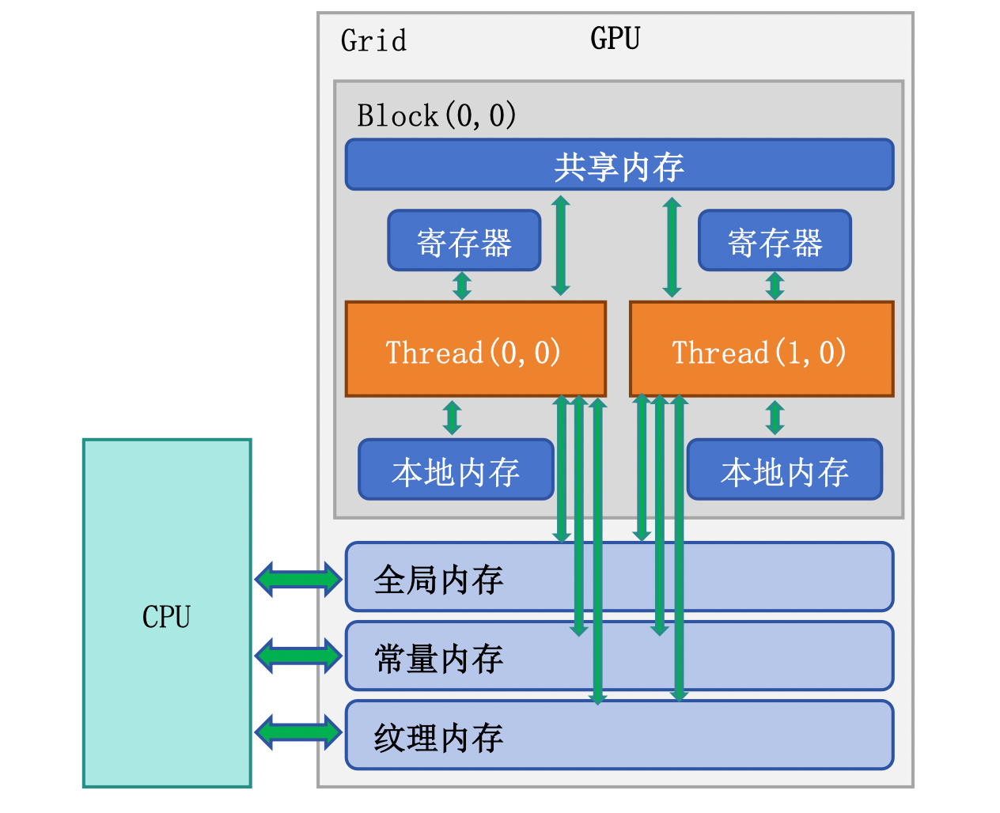
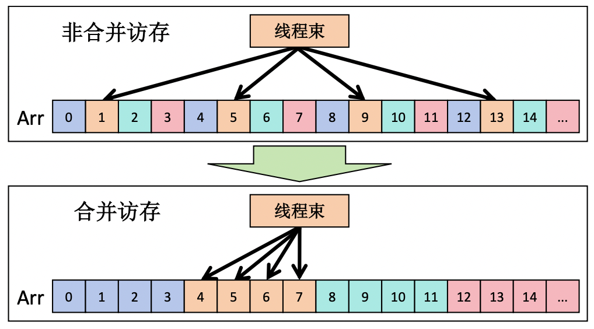
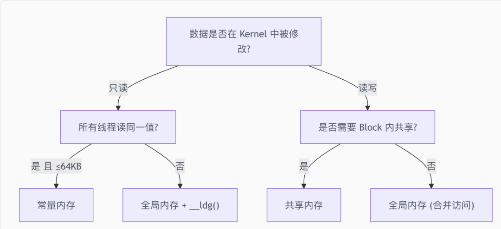

## 环境配置

### 硬件要求
* NVIDIA GPU（Compute Capability >= 7.0，即 Volta 架构及以上）
* 建议至少 8GB 显存

什么是 Compute Capability？ 它是 NVIDIA GPU 的“能力版本号”，用于表示硬件支持哪一代 PTX 指令集和硬件特性。例如 sm_90 对应 Hopper（H100），sm_100 对应 Blackwell（B200）。

### 安装 CUDA
```shell
# Ubuntu 22.04
wget https://developer.download.nvidia.com/compute/cuda/repos/ubuntu2204/x86_64/cuda-keyring_1.1-1_all.deb
sudo dpkg -i cuda-keyring_1.1-1_all.deb
sudo apt-get update
sudo apt-get install cuda-toolkit-12-3

# 设置环境变量（加到 ~/.bashrc 或 ~/.zshrc）
export PATH=/usr/local/cuda/bin:$PATH
export LD_LIBRARY_PATH=/usr/local/cuda/lib64:$LD_LIBRARY_PATH
```

验证安装：
```shell
nvcc --version          # 查看 CUDA 编译器版本
nvidia-smi              # 查看 GPU 信息和驱动版本
```

### 编译 CUDA 程序
```shell
# 基础编译
nvcc hello.cu -o hello

# 指定 GPU 架构（推荐）
nvcc -arch=sm_80 hello.cu -o hello    # A100
nvcc -arch=sm_90 hello.cu -o hello    # H100

# 查看寄存器和共享内存使用量（调优时必用）
nvcc -Xptxas -v hello.cu -o hello
```

## 核函数
核函数是在 GPU 上执行的函数，使用 `__global__ `关键字声明。调用时通过 `<<<gridDim, blockDim>>>` 语法指定并行规模：

```cpp
// 声明核函数
__global__ void myKernel(float* data, int n) {
    int idx = blockIdx.x * blockDim.x + threadIdx.x;
    if (idx < n) {
        data[idx] *= 2.0f;
    }
}

// 调用核函数：128 个 Block，每个 Block 256 个线程
myKernel<<<128, 256>>>(data, n);
```

Grid 和 Block 都支持 1D、2D、3D 形式，例如：
```cpp
// 1D 情况（最常用）
int idx = blockIdx.x * blockDim.x + threadIdx.x;

// 2D 情况（矩阵运算常用）
int row = blockIdx.y * blockDim.y + threadIdx.y;
int col = blockIdx.x * blockDim.x + threadIdx.x;

// 使用 dim3 指定 2D 维度
dim3 blockDim(16, 16);     // 每个 Block 16x16 = 256 个线程
dim3 gridDim(
    (width + 15) / 16,     // x 方向 Block 数量
    (height + 15) / 16     // y 方向 Block 数量
);
kernel<<<gridDim, blockDim>>>(data, width, height);
```

设计约束：

| 参数 | 限制 |
| --- | --- |
| Block 内线程数 | 最多 1024 |
| Grid 每个维度的 Block 数 | 最多 2³¹ - 1 (x)，65535 (y, z) |
| 每 SM 活跃线程数 | 最多 2048（64 个 Warp） |
| 每 SM 活跃 Block 数 | 最多 32 |

Block Size 选择经验：

* 256：大多数场景的最佳起点（8 个 Warp）
* 128：访存密集型任务，需要更多 Block 并发
* 512-1024：计算密集型任务，注意寄存器和共享内存压力
* 始终是 32 的倍数：与 Warp 大小对齐，避免浪费

## 内存管理
CUDA 需要显式管理 CPU（Host）和 GPU（Device）之间的内存：

```cpp
float* d_data;  // d_ 前缀表示 device 内存

// 1. 分配 GPU 内存
cudaMalloc(&d_data, n * sizeof(float));

// 2. CPU → GPU 数据传输
cudaMemcpy(d_data, h_data, n * sizeof(float), cudaMemcpyHostToDevice);

// 3. 执行 kernel
myKernel<<<gridDim, blockDim>>>(d_data, n);

// 4. GPU → CPU 数据传输
cudaMemcpy(h_data, d_data, n * sizeof(float), cudaMemcpyDeviceToHost);

// 5. 释放 GPU 内存
cudaFree(d_data);
```

**异步传输与 Stream**：
默认情况下，`cudaMemcpy` 是同步的（会阻塞 CPU）。使用 Stream 可以实现异步传输和计算重叠：

```cpp
cudaStream_t stream;
cudaStreamCreate(&stream);

// 异步传输（CPU 不会阻塞）
cudaMemcpyAsync(d_data, h_data, size, cudaMemcpyHostToDevice, stream);

// 在同一 stream 中启动 kernel（会等传输完成后执行）
myKernel<<<gridDim, blockDim, 0, stream>>>(d_data, n);

// 异步回传结果
cudaMemcpyAsync(h_data, d_data, size, cudaMemcpyDeviceToHost, stream);

// 等待 stream 中所有操作完成
cudaStreamSynchronize(stream);
cudaStreamDestroy(stream);
```
使用异步传输时，CPU 端内存必须是锁页内存（Pinned Memory），否则传输速度会大幅下降：
```cpp
float* h_pinned;
cudaMallocHost(&h_pinned, size);  // 分配锁页内存，传输速度提升 2-3x
// ... 使用 ...
cudaFreeHost(h_pinned);            // 释放锁页内存
```

## 错误处理
CUDA API 调用可能失败，生产代码中必须检查错误：
```cpp
#define CUDA_CHECK(call) do { \
    cudaError_t err = call; \
    if (err != cudaSuccess) { \
        fprintf(stderr, "CUDA error at %s:%d: %s\n", \
                __FILE__, __LINE__, cudaGetErrorString(err)); \
        exit(EXIT_FAILURE); \
    } \
} while(0)

// 使用
CUDA_CHECK(cudaMalloc(&d_data, size));
CUDA_CHECK(cudaMemcpy(d_data, h_data, size, cudaMemcpyHostToDevice));

// kernel 启动后检查错误
myKernel<<<gridDim, blockDim>>>(d_data, n);
CUDA_CHECK(cudaGetLastError());           // 检查启动参数错误
CUDA_CHECK(cudaDeviceSynchronize());      // 检查执行错误
```

## 内存模型
CUDA 的内存层次是性能优化的核心。“内存访问模式决定运行速度”——这是 CUDA 编程最重要的直觉。

GPU 的计算能力极强——一块 A100 的峰值算力为 312 TFLOPS（FP16，Tensor Core 含稀疏加速），但它的显存带宽只有约 2 TB/s。做一道简单的算术：一次浮点乘加（FMA）需要读 2 个 float（8 Bytes）产生 2 个 FLOP，那么 2 TB/s 带宽最多喂饱 500 GFLOPS 的计算——不到峰值算力的 0.2%。

这意味着：**绝大多数 Kernel 的性能瓶颈不是计算，而是内存访问**。理解 CUDA 的多层内存层次，学会把数据放在”离计算最近的地方”，是优化 GPU 程序的第一课。



```
寄存器 (Registers)           ← 最快，每线程私有
  │  ~20 TB/s, ~0 cycle
  ▼
共享内存 (Shared Memory)     ← 可编程的片上缓存，Block 内共享
  │  ~20 TB/s, ~20-30 cycles
  ▼
L1 / L2 Cache               ← 自动管理的硬件缓存
  │  L2: ~12 TB/s, ~200 cycles
  ▼
全局内存 (Global Memory/HBM) ← "显存"，所有线程可访问
  │  ~3.35 TB/s (H100), ~400-600 cycles
  ▼
主机内存 (Host/CPU Memory)   ← 需要通过 PCIe 传输
     ~64 GB/s (PCIe 5.0)
```

术语上，SM 的 L1 数据缓存由 SRAM 实现，速度约比寄存器慢一个数量级；全局内存由 DRAM 实现，容量大但延迟长。GPU 快速并不是因为它没有内存延迟，而是因为**有足够多的 Warp 可以随时切换来掩盖延迟。**


### 寄存器
寄存器是最快的存储，kernel 中的局部变量默认分配在寄存器中：
```cpp
__global__ void kernel(float* data, int n) {
    // a, b, result 都在寄存器中
    float a = data[threadIdx.x];
    float b = a * 2.0f;
    float result = a + b;
    data[threadIdx.x] = result;
}
```

注意事项：

* 每个 SM 的寄存器总量有限（H100 每 SM 65536 个 32-bit 寄存器）
* 每个线程用的寄存器越多，SM 上能同时运行的线程就越少（影响 Occupancy）
* 寄存器用完会”溢出”到 Local Memory（实际是 HBM），速度骤降

查看寄存器使用：

```shell
nvcc -Xptxas -v kernel.cu
# 输出: ptxas info: Used 32 registers, 0 bytes smem
# 如果看到 "stack frame" 或 "spill" 说明有溢出
```

寄存器溢出（Register Spilling）：

* 每个 SM 的寄存器总量有限（如 A100 为 65536 个 32-bit 寄存器/SM）。当一个线程使用的寄存器超过 SM 能分配给它的数量时，多出的变量会”溢出”到局部内存（实际是全局内存的一块区域，有 L1/L2 缓存加速但延迟仍然高）。

```shell
# 查看 Kernel 的寄存器用量
nvcc --ptxas-options=-v mykernel.cu
# ptxas info: Used 48 registers, 0 bytes smem

# 限制最大寄存器数（可能导致溢出但提高占用率）
nvcc --maxrregcount=32 mykernel.cu
```

### 共享内存
共享内存是程序员可控的片上高速缓存（SM 上），48~228KB/SM（因架构而异），相当于同一个 Block 内线程共享的”黑板”——任何一个线程往上面写了东西，同 Block 的其他线程都能看到，而且读写速度比全局内存快得多。它的典型用途是**缓存从全局内存加载的数据，供 Block 内线程重复使用。**
```cpp
__global__ void sharedMemDemo(float* input, float* output, int n) {
    // 静态分配共享内存
    __shared__ float smem[256];

    int idx = blockIdx.x * blockDim.x + threadIdx.x;

    // 1. 从全局内存加载到共享内存
    if (idx < n) {
        smem[threadIdx.x] = input[idx];
    }

    // 2. 同步：确保所有线程都加载完毕
    __syncthreads();

    // 3. 从共享内存读取（可以读邻居的数据，速度极快）
    if (idx < n && threadIdx.x > 0) {
        output[idx] = smem[threadIdx.x] + smem[threadIdx.x - 1];
    }
}
```

动态共享内存——大小在 kernel 启动时指定：
```cpp
// 动态声明：运行时确定大小
__global__ void dynamicSharedMem(float* data, int N) {
    extern __shared__ float sharedData[];  // 大小在启动时指定

    int idx = blockIdx.x * blockDim.x + threadIdx.x;
    if (idx < N) {
        sharedData[threadIdx.x] = data[idx];
    }
    __syncthreads();
    // ...
}

// 启动时通过第三个参数指定动态共享内存大小
int sharedMemSize = blockSize * sizeof(float);
dynamicSharedMem<<<grid, block, sharedMemSize>>>(data, N);
```

现代 GPU（sm_80+）的 L1 Cache 和共享内存共享同一块物理 SRAM，可以通过 API 配置比例：

```cpp
// 优先分配更多共享内存（最大 164KB on A100）
cudaFuncSetAttribute(myKernel,
    cudaFuncAttributeMaxDynamicSharedMemorySize, 164 * 1024);

// 设置 L1/Shared Memory 偏好
cudaFuncSetCacheConfig(myKernel, cudaFuncCachePreferShared);
```

### HBM
`cudaMalloc` 分配的内存、kernel 参数中的指针都指向全局内存。

```cpp
// 分配设备内存
float* d_data;
size_t size = N * sizeof(float);
cudaMalloc(&d_data, size);

// Host → Device 传输
cudaMemcpy(d_data, h_data, size, cudaMemcpyHostToDevice);

// Device → Host 传输
cudaMemcpy(h_result, d_data, size, cudaMemcpyDeviceToHost);

// 释放设备内存
cudaFree(d_data);
```

合并访问（Coalesced Access） 是全局内存优化的黄金法则：同一个 Warp 内的 32 个线程应该访问连续的内存地址，GPU 以 32B/64B/128B 的粒度从全局内存取数据（一次”事务”），如果 Warp 内线程访问的地址连续，一次事务就能满足所有线程，这样硬件可以将多次访问合并为少量内存事务。



```cpp
// ✅ 合并访问：连续线程访问连续地址
// Thread 0 → data[0], Thread 1 → data[1], ...
float val = data[threadIdx.x + blockIdx.x * blockDim.x];

// ❌ 跨步访问：效率低
// Thread 0 → data[0], Thread 1 → data[stride], ...
float val = data[(threadIdx.x + blockIdx.x * blockDim.x) * stride];
```

**数据布局优化**——AoS 转 SoA：
```cpp
// AoS (Array of Structures) —— 对 GPU 不友好
struct Particle { float x, y, z, w; };
Particle particles[N];
// 访问所有 x：particles[0].x, particles[1].x, ... 跨步为 16B

// SoA (Structure of Arrays) —— 对 GPU 友好
struct Particles {
    float x[N];  // 所有 x 连续存放
    float y[N];
    float z[N];
    float w[N];
};
// 访问所有 x：连续内存，完美合并
```

在设计数据结构时，优先选择 Structure of Arrays (SoA) 而非 Array of Structures (AoS)，因为 SoA 更容易实现合并访问。

### 常量内存

适合所有线程读取相同值的场景（广播模式），有专用缓存。

常量内存（Constant Memory）是一块 64KB 的 **只读** 全局内存区域，配有专用的常量缓存。当 Warp 内所有线程读取同一地址时，一次缓存读取就能广播给 32 个线程。

```cpp
// 在全局作用域声明常量内存
__constant__ float coefficients[256];

// 主机端拷贝数据到常量内存
float h_coeff[256];
// ... 填充 h_coeff ...
cudaMemcpyToSymbol(coefficients, h_coeff, sizeof(h_coeff));

// Kernel 中直接读取（像全局变量一样）
__global__ void applyFilter(float* data, float* output, int N) {
    int idx = blockIdx.x * blockDim.x + threadIdx.x;
    if (idx < N) {
        float result = 0.0f;
        for (int i = 0; i < 256; i++) {
            result += data[idx + i] * coefficients[i];  // 所有线程读同一个 coefficients[i]
        }
        output[idx] = result;
    }
}
```

**注意点**： 如果 Warp 内不同线程访问常量内存的不同地址，访问会被串行化为 32 次读取，性能反而比全局内存更差。

### 纹理内存

纹理内存（Texture Memory）通过专用的纹理缓存访问全局内存，它针对二维空间局部性做了优化。在深度学习时代，纹理内存使用较少，但在图像处理和某些插值场景中仍有价值。

纹理内存的特点：
* 针对 2D 空间局部性优化的缓存策略
* 支持硬件插值（线性/双线性）
* 支持自动边界处理（Clamp/Wrap）
* 对不规则访问模式比全局内存表现更好

在 CUDA 12+ 中，L1/L2 缓存的优化已经覆盖了大部分纹理内存的使用场景。对于新代码，建议：

* 规则访问模式 → 直接使用全局内存 + L1 缓存
* 只读数据 → 使用 __ldg() 内置函数走只读缓存路径
* 需要硬件插值 → 仍然使用纹理

```cpp
// __ldg() 走只读缓存路径，无需配置纹理对象
float val = __ldg(&input[idx]);
```


### 统一内存

统一内存（Unified Memory）是 CUDA 6.0 引入的编程抽象——它提供一个单一地址空间，CPU 和 GPU 都可以通过相同的指针访问数据，系统自动在两者之间迁移页面。

```cpp
// 分配统一内存
float* data;
cudaMallocManaged(&data, N * sizeof(float));

// CPU 端初始化——直接用指针
for (int i = 0; i < N; i++) {
    data[i] = (float)i;
}

// GPU 端计算——同一个指针
myKernel<<<grid, block>>>(data, N);
cudaDeviceSynchronize();

// CPU 端读取结果——还是同一个指针
printf("Result: %f\n", data[0]);

// 释放
cudaFree(data);
```

统一内存的”魔法”背后是操作系统级别的按需页面迁移：
1、 CPU 首次写入时，页面驻留在系统内存
2、 GPU Kernel 访问时触发缺页中断，驱动将页面迁移到显存
3、 Kernel 执行完后 CPU 再次访问，页面迁回系统内存

自动按需迁移有延迟开销，可以通过预取（Prefetch）提前触发迁移：

```cpp
// 在 Kernel 启动前，预取数据到 GPU
int device;
cudaGetDevice(&device);
cudaMemPrefetchAsync(data, N * sizeof(float), device);

myKernel<<<grid, block>>>(data, N);
cudaDeviceSynchronize();

// Kernel 完成后，预取结果到 CPU
cudaMemPrefetchAsync(data, N * sizeof(float), cudaCpuDeviceId);
```

统一内存简化了编程但可能牺牲性能。对于性能敏感的代码，显式使用 cudaMemcpy 通常比统一内存快，因为你可以精确控制数据传输时机并与计算重叠。

### 典型优化模式：Tiling

Tiling 是最经典的内存优化模式——将全局内存数据分块加载到共享内存，在共享内存上做多次计算，从而用少量全局内存访问换取大量快速的共享内存访问：

```cpp
__global__ void matmulTiled(float* A, float* B, float* C,
                            int M, int N, int K) {
    __shared__ float As[TILE][TILE];
    __shared__ float Bs[TILE][TILE];

    int row = blockIdx.y * TILE + threadIdx.y;
    int col = blockIdx.x * TILE + threadIdx.x;
    float sum = 0.0f;

    for (int t = 0; t < (K + TILE - 1) / TILE; t++) {
        // 协作加载 tile 到共享内存
        if (row < M && t * TILE + threadIdx.x < K)
            As[threadIdx.y][threadIdx.x] = A[row * K + t * TILE + threadIdx.x];
        else
            As[threadIdx.y][threadIdx.x] = 0.0f;

        if (col < N && t * TILE + threadIdx.y < K)
            Bs[threadIdx.y][threadIdx.x] = B[(t * TILE + threadIdx.y) * N + col];
        else
            Bs[threadIdx.y][threadIdx.x] = 0.0f;

        __syncthreads();

        // 在共享内存上计算
        for (int k = 0; k < TILE; k++) {
            sum += As[threadIdx.y][k] * Bs[k][threadIdx.x];
        }
        __syncthreads();
    }

    if (row < M && col < N) {
        C[row * N + col] = sum;
    }
}
```

因为共享内存很小（几十 KB），装不下整个矩阵，所以把大矩阵切成一块块 TILE × TILE（比如 16×16）的小方块，一块一块地处理。


Tiling 的核心思想——“搬一次数据，用多次”——在 FlashAttention、GEMM 优化等高级场景中反复出现，是 GPU 编程最重要的优化范式之一。

**1. 为什么要分块？** 朴素矩阵乘法中每个线程要从全局内存读 A 的一整行和 B 的一整列，而全局内存很慢（几百个时钟周期），且相邻线程会重复读取相同数据。核心思路是把数据先搬到快几百倍的共享内存，让一个 block 内的线程协作加载、共享复用。

**2. 矩阵乘法可以按块分解。** 计算 C 的一个 tile，等于 A 的一行 tile 和 B 的一列 tile 两两相乘再累加：

```
        B 的 tiles
      ┌────┬────┬────┐
      │ B0 │ B1 │ B2 │
      └────┴────┴────┘
A 的 tiles         ↓ 累加
┌────┐          ┌─────┐
│ A0 │ A1 │ A2  │  C  │ ← C[块] = A0·B0 + A1·B1 + A2·B2
└────┘          └─────┘
```

外层 `for (int t = ...)` 循环就是沿着 K 维度，一个 tile 一个 tile 地累加。`(K + TILE - 1) / TILE` 是向上取整，算出 K 方向要分成多少个 tile。

**3. 线程坐标。** `row`/`col` 是该线程在整个大矩阵里的全局坐标，`threadIdx.y`/`threadIdx.x` 是它在当前 tile（block）内的局部坐标。每个线程最终负责计算 `C[row][col]` 一个元素，同时每一轮负责协作搬运 `As`、`Bs` 各一个元素。

**4. 协作加载。** 以 A 为例，全局下标 `A[row * K + t * TILE + threadIdx.x]` 中：行 = `row`，列 = `t * TILE + threadIdx.x`（第 t 个 tile 的起始列加上 tile 内偏移）。B 同理。两处 `if...else` 是边界保护：当 M、N、K 不是 TILE 整数倍时，越界位置填 `0.0f`（补 0 不影响乘加结果）。

**5. 两个 `__syncthreads()` 的作用。** 共享内存是整个 block 共享的：

- 第一个屏障确保所有线程都把自己负责的那格搬进 `As`/`Bs` 后，才开始计算，避免读到尚未写入的垃圾数据。
- 第二个屏障确保所有线程都用完当前 `As`/`Bs` 的数据后，才进入下一轮覆盖写入新 tile，避免快线程提前覆盖掉别人还在读的旧数据。

**6. 在共享内存上计算。** 内层循环 `sum += As[threadIdx.y][k] * Bs[k][threadIdx.x]` 与朴素版结构相同，但数据来自快速的共享内存，且 `k` 只在当前 tile（`0 ~ TILE-1`）内遍历。`t` 走完所有 tile 后，`sum` 即为完整的 `C[row][col]`，最后在边界检查内写回全局内存。

整体流程：

```
每个线程负责 C 中一个元素，一个 block 负责 C 中一个 TILE×TILE 块

for t = 0, 1, 2, ... (沿 K 方向切块):
    1. 每个线程搬 A 的一格 → As，搬 B 的一格 → Bs   （协作加载，边界补 0）
    __syncthreads()   等全员搬完                      （屏障 1）
    2. 在 As/Bs（快内存）上算 TILE 次乘加             （计算）
       sum += As[ty][k] * Bs[k][tx]
    __syncthreads()   等全员算完                      （屏障 2）
最后: C[row][col] = sum
```

#### 用一个 4×4 的小例子理解“分块”

如果上面的抽象描述还是难理解，我们用具体数字走一遍。设 A、B、C 都是 `4×4` 矩阵，`TILE = 2`（每次只处理 2 个元素，分两批）。

**先看不分块时怎么算。** 矩阵乘法规则是「C 的每个元素 = A 的某一行 · B 的某一列」。例如算 `C[0][0]`，要用 A 的第 0 行整行和 B 的第 0 列整列：

```
C[0][0] = A[0][0]*B[0][0] + A[0][1]*B[1][0] + A[0][2]*B[2][0] + A[0][3]*B[3][0]
          └──────────────────── 4 项相加 ────────────────────┘
```

**分块的本质，就是把这一长串乘加沿 K 方向切成几段，分批算。** 把上面 4 项拆成两段：

```
C[0][0] = [A[0][0]*B[0][0] + A[0][1]*B[1][0]]  ← 第 1 段（t=0，前 2 个）
        + [A[0][2]*B[2][0] + A[0][3]*B[3][0]]  ← 第 2 段（t=1，后 2 个）
```

最终结果没变，只是「先算前半段，再算后半段，加起来」。外层 `for (int t = ...)` 循环就是在做这件事：`t=0` 算第 1 段，`t=1` 算第 2 段，`sum` 把两段累加。

**从块的视角看。** `TILE=2` 时，`4×4` 矩阵被切成 `2×2` 的小方块：

```
      A                    B                    C
┌────┬────┐          ┌────┬────┐          ┌────┬────┐
│ A00│ A01│          │ B00│ B01│          │ C00│ C01│
├────┼────┤    ×     ├────┼────┤    =     ├────┼────┤
│ A10│ A11│          │ B10│ B11│          │ C10│ C11│
└────┴────┘          └────┴────┘          └────┴────┘
```

按块来看，乘法规则和元素级完全一样：

```
C00(块) = A00(块) × B00(块)  +  A01(块) × B10(块)
          └─── t=0 ───┘        └─── t=1 ───┘
```

对照上面 `C[0][0]` 的拆分：`t=0` 段用的正是 A 的左上块 `A00` 和 B 的左上块 `B00`；`t=1` 段用的正是 A 的右上块 `A01` 和 B 的左下块 `B10`。

**走一遍 t 循环。** 负责计算 `C00` 块的，是一个 `2×2 = 4` 个线程的 block。第一轮 `t=0`：

1. 协作加载：4 个线程各搬一个元素，把 A 的 `A00` 块、B 的 `B00` 块搬进共享内存 `As`、`Bs`。
2. `__syncthreads()`：等 4 个线程都搬完。
3. 计算：负责 `C[0][0]` 的线程做内层循环（`k=0,1`），`sum += As[0][0]*Bs[0][0] + As[0][1]*Bs[1][0]`，正好是第 1 段。
4. `__syncthreads()`：等大家算完，准备搬下一块。

第二轮 `t=1`：搬 A 的 `A01` 块、B 的 `B10` 块进共享内存，算出 `A[0][2]*B[2][0] + A[0][3]*B[3][0]` 累加到 `sum`。两轮结束，`sum = 第 1 段 + 第 2 段 = C[0][0]` 的完整结果。

**复用在哪里（分块真正的收益）。** `As`、`Bs` 是整个 block 共享的。`t=0` 搬进来的 `A00` 块不只给算 `C[0][0]` 的线程用：

- 算 `C[0][0]` 和 `C[0][1]` 的线程都用 `As` 的第 0 行 —— 同一份数据复用。
- 算 `C[1][0]` 和 `C[1][1]` 的线程都用 `As` 的第 1 行 —— 同样复用。

搬一次 `A00` 进共享内存，block 里多个线程反复用；若不分块，这些数据每个线程都要各自从慢速全局内存重复读一遍。这正是「搬一次数据，用多次」的含义。


### 总结



| 需求 | 首选方案 | 次选方案 |
| --- | --- | --- |
| Block 内线程间数据交换 | 共享内存 + __syncthreads() | Warp Shuffle（同 Warp 内） |
| 全局只读广播 | 常量内存 | __ldg() |
| 大数组逐元素处理 | 全局内存（合并访问） | — |
| 局部累加器/计数器 | 寄存器 | — |
| 复杂数据结构快速原型 | 统一内存 | — |
| 减少全局内存事务 | Tiling + 共享内存 | L1 缓存 |


## Warp
Warp 是 GPU 执行的最小调度单位，由 32 个连续线程 组成。同一个 Warp 内的线程在同一时刻执行相同的指令（SIMT）。可以把 Warp 想象成一排 32 个士兵齐步走，步调必须一致——如果有人要向左转、有人要向右转，就只能先让一拨人转完，再让另一拨人转，效率减半。

```
Block (256 threads)
├── Warp 0: Thread 0-31
├── Warp 1: Thread 32-63
├── Warp 2: Thread 64-95
├── ...
└── Warp 7: Thread 224-255
```

### Warp Divergence（分支发散）
当 Warp 内的线程走不同的 if/else 分支时，两个分支必须串行执行，导致性能减半：
```cpp
// 坏：Warp 内一半线程走 if，一半走 else
if (threadIdx.x < 16) {
    doA();  // Warp 内 thread 0-15 执行，16-31 等待
} else {
    doB();  // Warp 内 thread 16-31 执行，0-15 等待
}

// 好：让整个 Warp 走同一分支
if (threadIdx.x / 32 < someValue) {  // 以 Warp 为粒度分支
    doA();  // 整个 Warp 执行
}
```

### Warp 级原语
Warp 内线程可以直接交换数据，无需共享内存：
```cpp
// Warp Shuffle：线程间直接交换寄存器值
float val = __shfl_down_sync(0xFFFFFFFF, myVal, delta);
// 线程 i 获取线程 i+delta 的值

float val = __shfl_xor_sync(0xFFFFFFFF, myVal, mask);
// 线程 i 获取线程 i^mask 的值（蝶形交换）

// Warp 级归约（Volta+）
float sum = __reduce_add_sync(0xFFFFFFFF, myVal);
// 一条指令完成 Warp 内求和
```

**Warp 是硬件的执行细节，也是性能的关键。 严格来说，Warp 并不属于 CUDA 编程模型的线程层次结构（Thread → Block → Grid），而是 GPU 硬件实现该模型的方式。它有点像 CPU 的缓存行：正确性问题必须保证，但性能上你必须顺应它。**


硬件上，一个 SM 有若干 **Warp 调度器**，每个周期从一组就绪的 Warp 中挑一个发射指令。GPU 的高吞吐力量并不靠把单个线程做得很聪明，而是靠**同时供养大量 Warp**，让某个 Warp 等在内存时马上切换到另一个 Warp——这种机制叫 **延迟隐藏（latency hiding）**。为了让它生效，你需要尽量让 SM 上有足够多的活跃 Warp；这也解释了为什么 Block 太小、寄存器太多或者共享内存占用过多，都会让 GPU“没活干”。

### Bank Conflict

共享内存被分为 **32 个 Bank**，每个 Bank 宽度为 4 字节。共享内存是按 4 字节 为单位，**循环分配**到 32 个 Bank 上的。**同一 Warp 内的不同线程如果访问同一 Bank 的不同地址，就会产生 Bank Conflict**，访问变为串行。可以把 Shared Memory 的 32 个 Bank 想象成银行的 32 个柜台，如果多个线程同时排到同一个柜台，就得排队等候；理想情况是每个线程各去一个柜台，大家同时办完。

```cpp
__shared__ float smem[32][32];

// 无 Bank Conflict：每个线程访问不同 Bank
float val = smem[0][threadIdx.x];  // 线程 i 访问 Bank i

// 32-way Bank Conflict：所有线程访问同一 Bank
float val = smem[threadIdx.x][0];  // 列访问，所有线程都访问 Bank 0

// 经典解决方案：Padding
__shared__ float smem[32][32 + 1];     // 多加一列，错开 Bank
float val = smem[threadIdx.x][0];  // 现在线程 i 访问 Bank i，无冲突
```

这里存在一种广播机制：如果所有线程同时访问同一 Bank，那么它们的值会被自动广播到其他线程。

```cpp
// ✅ 广播无冲突：所有线程读同一地址
float val = shared[0];                   // 广播，无冲突
```

检测 Bank Conflict：
```shell
ncu --metrics l1tex__data_bank_conflicts_pipe_lsu_mem_shared_op_ld.sum ./app
# 输出为 0 表示无 Bank Conflict
```

共享内存以 32 个 Bank、每个 Bank 4 字节组织，连续 4 字节会映射到下一个 Bank。所以“连续访问”在全局内存里对应合并访问，在共享内存里对应无 Bank Conflict；跨步访问则会让不同线程扎堆到同一 Bank，访问被串行化。结构体（AoS 转 SoA）就是你数据布局上的核心实践，本质上也是在避免这种跨步。

### Occupancy

Occupancy = 实际活跃 Warp 数 / SM 最大 Warp 数。它反映了 GPU 并行度的利用程度。

影响 Occupancy 的三个因素：

| 因素 | 影响 | 调优方向 |
| --- | --- | --- |
| 每线程寄存器数 | 寄存器多 → 每 SM 能容纳的线程少 | 减少局部变量、控制循环展开 |
| 每 Block 共享内存 | 共享内存多 → 每 SM 能容纳的 Block 少 | 合理分配，避免浪费 |
| Block 大小 | 太小或太大都不好 | 256 是常用起点 |

```cpp
// 让编译器帮你计算最优 Block Size
int minGridSize, blockSize;
cudaOccupancyMaxPotentialBlockSize(&minGridSize, &blockSize, myKernel, 0, 0);
printf("Optimal block size: %d\n", blockSize);
```

**重要提醒**：Occupancy 不是越高越好。对于 Tensor Core 密集型 kernel，25-50% 的 Occupancy 就可能达到峰值性能。**先保证没有寄存器溢出，再考虑 Occupancy。**

**为什么不是越高越好？** Occupancy 的目标是“用足够多的活跃 Warp 去延迟隐藏”，一旦 Warp 数量已经能覆盖内存访问的等待周期，再增加 Warp 反而会分掉每个线程可用的寄存器空间、降低每个 Block 能使用的共享内存，或者引入更多同步与缓存压力。高性能 GEMM 有时候只需要很低的 Occupancy，只要 Tensor Core 能被打满就够了。优化的最终目标，是让当前受限制的资源（算力或内存带宽）利用率尽量高，而不是一味追求 Occupancy。


### 性能天花板：算术强度与 Roofline
写 Kernel 时最常见的困惑是“为什么这个 Kernel 很慢？” 大多数时候，答案要么是内存受限（memory-bound），要么是计算受限（compute-bound）。

* 内存受限：瓶颈是 GPU 把数据从显存搬到 SM 的速度（内存带宽）。
* 计算受限：瓶颈是 CUDA Core 或 Tensor Core 的算术吞吐量（算术带宽）。

为了判断是哪种，可以用 Roofline 模型的简化版本：估一下你的 Kernel“每个字节的搬运对应多少次算术操作”，这个比值叫算术强度（arithmetic intensity）。如果算术强度高，Kernel 更容易受计算限制；如果低，则更容易受内存限制。

比如逐元素加/ReLU 这类算子，每读一个 float 只做一两次操作，算术强度很低，所以它们通常是 **memory-bound**——这也是为什么算子融合（fusing）能大幅提速：它把多个 memory-bound 步骤合并，避免中间的全局内存读写。反过来，矩阵乘法 O(N³) 计算 / O(N²) 内存，算术强度随 N 线性增长，天生适合 GPU；只要分块（Tiling）把全局内存访问次数降下来，就能逼近计算受限。

用 Nsight Compute 看 `Compute (SM) Throughput` 和 `Memory Throughput` 两个指标，就能快速判断当前 Kernel 卡在哪个屋顶下面。

为了有个具体数字感，下表列出几个现代数据中心 GPU 在 BF16 Tensor Core 情况下的“脊点”（算术强度到多少才能从内存受限转为计算受限）：

| 系统 | 算术带宽 (TFLOPs/s) | 内存带宽 (TB/s) | 脊点 (FLOPs/byte) |
| --- | --- | --- | --- |
| A100 80GB SXM / HBM2e | ~312 | ~2 | ~156 |
| H100 SXM / HBM3 | ~989 | ~3.35 | ~295 |
| B200 / HBM3e | ~2250 | ~8 | ~281 |

直观理解：在 A100 上，你的 Kernel 至少要做到“每搬运 1 字节，顺便执行约 156 次浮点操作”才能有望打到算力天花板；而多数逐元素算子远达不到这个值，所以它们注定先撞内存带宽墙。

**CUDA 计时**：

CUDA Event 是 GPU 端精确计时的标准方法，精度达微秒级：

```cpp
cudaEvent_t start, stop;
cudaEventCreate(&start);
cudaEventCreate(&stop);

// 计时开始
cudaEventRecord(start);

// 要计时的操作
vectorAdd<<<gridSize, blockSize>>>(d_A, d_B, d_C, N);

// 计时结束
cudaEventRecord(stop);
cudaEventSynchronize(stop);

// 计算耗时
float milliseconds = 0;
cudaEventElapsedTime(&milliseconds, start, stop);
printf("GPU Kernel time: %.4f ms\n", milliseconds);

// 清理
cudaEventDestroy(start);
cudaEventDestroy(stop);
```

包含数据传输的端到端计时：
```cpp
cudaEventRecord(start);

cudaMemcpy(d_A, h_A, size, cudaMemcpyHostToDevice);
cudaMemcpy(d_B, h_B, size, cudaMemcpyHostToDevice);
vectorAdd<<<gridSize, blockSize>>>(d_A, d_B, d_C, N);
cudaMemcpy(h_C, d_C, size, cudaMemcpyDeviceToHost);

cudaEventRecord(stop);
cudaEventSynchronize(stop);

float totalTime = 0;
cudaEventElapsedTime(&totalTime, start, stop);
printf("GPU total (with memcpy): %.4f ms\n", totalTime);
```

算术强度（Arithmetic Intensity）= 计算量 / 内存访问量：

$$
AI = \frac{\text{FLOPs}}{\text{Bytes}} = \frac{1\ \text{FLOP}}{12\ \text{Bytes}} \approx 0.083\ \text{FLOP/Byte}
$$

这个值极低，说明向量加法是典型的**内存密集型**操作，性能受限于内存带宽而非计算能力。

带宽利用率分析：

如果 Kernel 时间为 0.3 ms，处理 $3 \times 2^{24} \times 4$ Bytes = 201 MB 数据：

$$
\text{有效带宽} = \frac{201\ \text{MB}}{0.3\ \text{ms}} \approx 670\ \text{GB/s}
$$

对比 RTX 4090 的理论峰值带宽 1008 GB/s，利用率约 66%——对于简单的 Kernel 来说已经不错。

## 第一个完整程序 -- 向量加法

```cpp
#include <stdio.h>
#include <cuda_runtime.h>

#define CUDA_CHECK(call) do { \
    cudaError_t err = call; \
    if (err != cudaSuccess) { \
        fprintf(stderr, "CUDA error at %s:%d: %s\n", \
                __FILE__, __LINE__, cudaGetErrorString(err)); \
        exit(EXIT_FAILURE); \
    } \
} while(0)

// 核函数：向量加法
__global__ void vectorAdd(const float* a, const float* b, float* c, int n) {
    int idx = blockIdx.x * blockDim.x + threadIdx.x;
    if (idx < n) {
        c[idx] = a[idx] + b[idx];
    }
}

int main() {
    const int N = 1 << 20;  // 1M 元素
    size_t bytes = N * sizeof(float);

    // 分配主机内存并初始化
    float* h_a = (float*)malloc(bytes);
    float* h_b = (float*)malloc(bytes);
    float* h_c = (float*)malloc(bytes);
    for (int i = 0; i < N; i++) {
        h_a[i] = 1.0f;
        h_b[i] = 2.0f;
    }

    // 分配设备内存
    float *d_a, *d_b, *d_c;
    CUDA_CHECK(cudaMalloc(&d_a, bytes));
    CUDA_CHECK(cudaMalloc(&d_b, bytes));
    CUDA_CHECK(cudaMalloc(&d_c, bytes));

    // Host → Device
    CUDA_CHECK(cudaMemcpy(d_a, h_a, bytes, cudaMemcpyHostToDevice));
    CUDA_CHECK(cudaMemcpy(d_b, h_b, bytes, cudaMemcpyHostToDevice));

    // 计算 Grid 和 Block 维度
    int blockSize = 256;
    int gridSize = (N + blockSize - 1) / blockSize;

    // 启动 Kernel
    vectorAdd<<<gridSize, blockSize>>>(d_a, d_b, d_c, N);
    CUDA_CHECK(cudaGetLastError());

    // Device → Host
    CUDA_CHECK(cudaMemcpy(h_c, d_c, bytes, cudaMemcpyDeviceToHost));

    // 验证
    for (int i = 0; i < N; i++) {
        if (h_c[i] != 3.0f) {
            printf("Error at index %d: %f\n", i, h_c[i]);
            break;
        }
    }
    printf("Vector addition completed successfully!\n");

    // 释放
    free(h_a); free(h_b); free(h_c);
    cudaFree(d_a); cudaFree(d_b); cudaFree(d_c);
    return 0;
}
```

编译执行：

```bash
nvcc -arch=sm_80 vector_add.cu -o vector_add && ./vector_add
```


